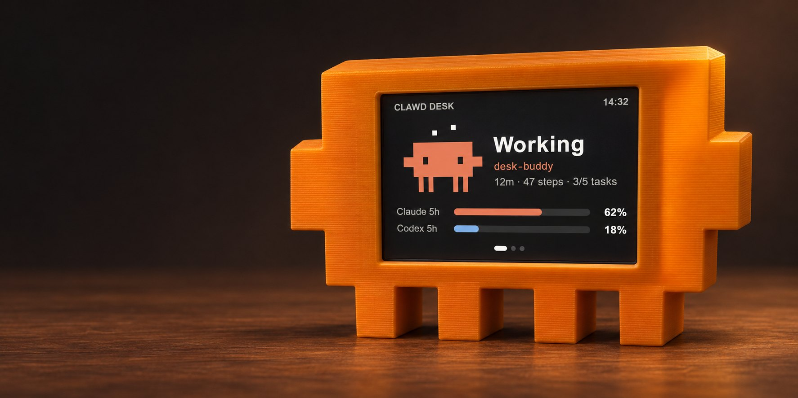
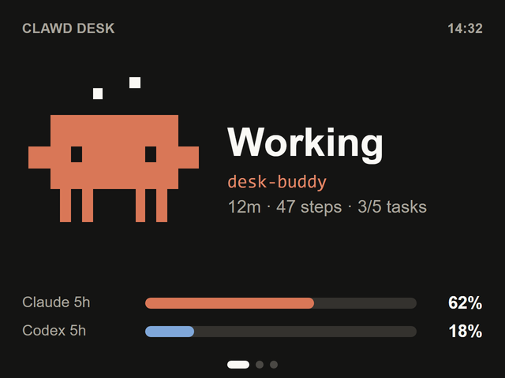
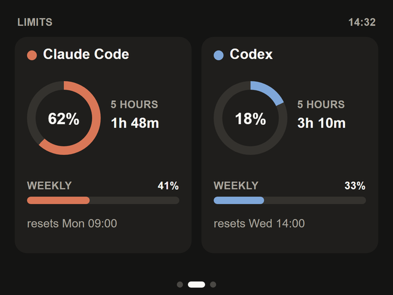
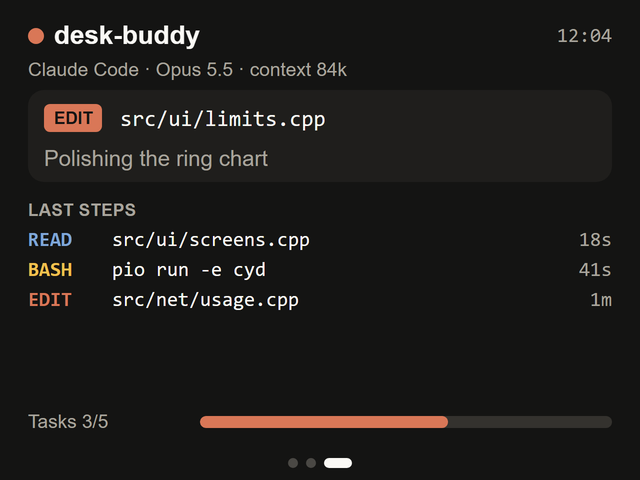
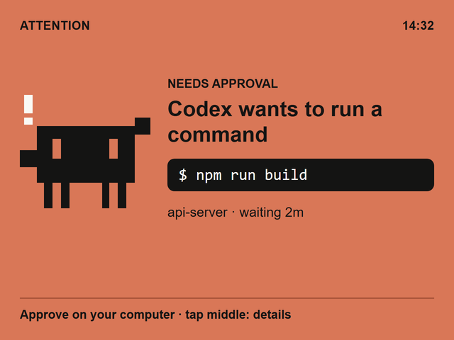

# Clawd Desk



A tiny Clawd for your desk. It shows your **Claude Code** and **Codex** usage limits, what your agent is doing right now, commands waiting for your approval, and your recent sessions, on a $10 ESP32 touchscreen.

**[Install it from your browser](https://emiryz-162.github.io/clawd-desk/)** · [Türkçe](README.tr.md)

<table>
  <tr>
    <td></td>
    <td></td>
  </tr>
  <tr>
    <td></td>
    <td></td>
  </tr>
</table>

> An independent fan project. Not affiliated with, endorsed by or sponsored by Anthropic or OpenAI.

**What makes it different:** you almost never have to touch it.

- It **rotates by itself** between Home, Limits and the live session every 10 seconds.
- When something needs you, it **jumps to the front**. If a command is waiting for approval, the screen stays there and the LED blinks yellow. When a job finishes, Clawd celebrates for 6 seconds.
- When you do want to tap, there are just **three big touch zones** (left, middle, right), so the board's imprecise resistive touch never misses.
- The **light sensor** dims it at night, and the **BOOT button** on the back works as a "next" button.

---

## What you need

| | |
|---|---|
| **The board** | ESP32-2432S028R, also called "Cheap Yellow Display" or CYD (2.8", 320×240). About $10–15 online. |
| **A USB data cable** | Some cables only charge. If your computer doesn't see the board, try another cable. |
| **A case** (optional) | The [clawd-meter case on MakerWorld](https://makerworld.com/en/models/2906020-clawd-meter) fits this board. Print it in orange. See [hardware/](hardware/README.md). |
| **A computer** | With Claude Code and/or Codex, and Chrome or Edge for the one-time install. |

## How it works

```
Claude Code / Codex           companion (Node.js, on your computer)      Clawd Desk (ESP32)
  session logs        ──►     reads them every 2 seconds        ──Wi-Fi──►  draws the screens,
  hooks, status line          builds a small JSON                or USB     animates Clawd,
                                                                            touch, LED
```

Everything stays on your computer and your home network. The companion reads files that Claude Code and Codex already write. It never sends your prompts anywhere except to the screen.

---

## Setup (about 5 minutes)

### Step 1: Put Clawd Desk on the board

1. Plug the board into your computer with the USB cable.
2. Open the **[Clawd Desk installer](https://emiryz-162.github.io/clawd-desk/)** in Chrome or Edge.
3. Pick your board type and click **Install Clawd Desk**. Not sure which board you have? Pick the first one.

Colors look like a photo negative (white background, blue Clawd)? **Hold the BOOT button on the back for 2 seconds** and let go. The board remembers it.

If it doesn't connect, hold the **BOOT** button on the back of the board and try again.

### Step 2: Connect the board to Wi-Fi

1. The screen says **Wi-Fi setup**.
2. On your phone, join the Wi-Fi network called **`ClawdDesk-Setup`**.
3. A page opens. If it doesn't, go to `192.168.4.1` in your browser. Pick your home Wi-Fi and enter its password.
4. The board connects and shows sample data. The top-left corner says `DEMO · 192.168.x.x`. That's the board's address.

> If the board already remembers a Wi-Fi network, it skips this step. To switch networks, hold **BOOT** for 5 seconds.

### Step 3: Set up your computer

**Windows:** download **[ClawdDesk-Setup.exe](https://github.com/Emiryz-162/clawd-desk/releases/latest/download/ClawdDesk-Setup.exe)** and double-click it. It finds the screen on your network, connects Claude Code, and starts with Windows from now on. That's it.

> Windows may say the app is from an unknown publisher, because it isn't code-signed. Click **More info → Run anyway**. The program is built from this repository by GitHub Actions ([release workflow](.github/workflows/release.yml)).

**macOS / Linux:** install [Node.js](https://nodejs.org) 18 or newer, download this repository (**Code → Download ZIP**), then in a terminal:

```bash
cd clawd-desk/companion
node src/cli.mjs setup
node src/cli.mjs run
```

To start it automatically, add a line to your crontab (`crontab -e`). Replace both paths: the project folder, and your Node.js (run `which node` to find it):

```bash
@reboot cd /path/to/clawd-desk/companion && /path/to/node src/cli.mjs run >> ~/.clawd-desk/companion.log 2>&1
```

Open <http://127.0.0.1:8787/> any time to see exactly what is being sent to the screen.

### Try it without real sessions

`clawd-desk.exe demo` (or `node src/cli.mjs demo`) cycles through every screen with fake data. Press `Ctrl+C` to stop.

### Remove it

`clawd-desk.exe uninstall` in `%LOCALAPPDATA%\ClawdDesk` (or `node src/cli.mjs uninstall`) removes the Claude Code hooks, the status line and the autostart entry. Then delete that folder.

<details>
<summary><b>For developers: build and flash from source</b></summary>

Firmware ([PlatformIO](https://platformio.org/install/ide?install=vscode)): open `firmware/` in VS Code and upload one of these environments, or use `pio run -e cyd -t upload`.

| Your board | Environment |
|---|---|
| Most boards (one micro USB port) | `cyd` |
| Starts with inverted colors (you can also hold BOOT for 2 s) | `cyd_inv` |
| Both micro USB and USB-C | `cyd2usb` |

On Windows with the VS Code extension, `pio` isn't on your PATH: `& "$env:USERPROFILE\.platformio\penv\Scripts\pio.exe" run -e cyd -t upload`.

Companion from source (Node.js 18+): `cd companion`, then `node src/cli.mjs setup`. Run `node src/cli.mjs` for all commands.

Build the Windows program: `cd companion && npm install && npm run build:exe` (on Windows).
Build the installer images: `python tools/build_web_firmware.py` (writes `site/firmware/`).

Releases: push a tag like `v0.2.0` and the [release workflow](.github/workflows/release.yml) attaches `ClawdDesk-Setup.exe` and full firmware images. The installer page is published by the [Pages workflow](.github/workflows/pages.yml) on every push to `main`.
</details>

---

## Using it

### Screens

| | Screen | When it shows |
|---|---|---|
| 1 | **Home** | Clawd's mood, the current job and two limit bars |
| 2 | **Limits** | Claude Code and Codex: 5-hour and weekly usage, with reset times |
| 3 | **Live session** | While a job is running: the current step, the last steps and the task list |
| 4 | **Needs approval** | When Claude or Codex asks for permission. It stays until you answer on your computer |
| 5 | **Sessions** | Your recent sessions. Tap the middle of the screen to open |
| 6 | **Session details** | Your request, time, steps, files, tokens and the last message |
| 7 | **Done!** | For 6 seconds when a job finishes |
| 8 | **Night** | When the room is dark: a big clock and a sleeping Clawd |

Screens 1–3 rotate on their own. 4, 7 and 8 appear when something happens. 5 and 6 only open when you tap.

### Touch zones

| | Left third | Middle third | Right third |
|---|---|---|---|
| Rotating screens | previous | open sessions | next |
| Session list | up | open details | down |
| Session details | back to list | home | next session |

If you don't touch anything for 15 seconds, it goes back to Home.

### LED and buttons

- **LED (on the back):** orange breathing = working, blinking yellow = needs approval, green = done.
- **BOOT button:** press for "next". Hold for 2 seconds to flip the colors (for panels that show them inverted). Hold for 5 seconds to forget the Wi-Fi.

### Language

The screen follows your computer's language automatically. English and Turkish are built in. Any other language falls back to English. To pick one yourself:

```bash
clawd-desk.exe config --lang en
```

(From source: `node src/cli.mjs config --lang en`.)

Adding another language takes two small files: `companion/src/i18n.mjs` and `firmware/src/lang.cpp`.

---

## Where the data comes from

| What | Source |
|---|---|
| Claude Code sessions | `~/.claude/projects/**/*.jsonl` (read only) |
| Codex sessions and limits | `~/.codex/sessions/**/rollout-*.jsonl` (read only) |
| Live status: working, needs approval, done | Claude Code hooks, sent to `127.0.0.1:8787` |
| Claude 5-hour and weekly limits | Every 3 minutes, the companion asks the same usage endpoint Claude Code's `/usage` screen uses, with the login Claude Code saved on your computer. If that fails, it uses the `rate_limits` that Claude Code passes to its status line. |

**About your Claude login:** Claude Code's access token only lasts a few hours, and if you mostly use the desktop app, nothing renews it. So when it expires, the companion renews it the same way Claude Code does and saves it back to `~/.claude/.credentials.json`, keeping everything else in that file as it was. Your login is never sent anywhere except to Anthropic.

The companion only listens on `127.0.0.1`. Apart from your screen, it only talks to Anthropic, for the usage request and the login renewal.

To undo the Claude Code changes at any time, run `uninstall` (see **Remove it** above).

---

## Troubleshooting

<details>
<summary><b>Colors look wrong (white background, blue Clawd)</b></summary>

Hold the **BOOT** button on the back of the board for 2 seconds and let go. The colors flip and the board remembers it. Some of these panels also look inverted when viewed from a low angle, so check from the front.
</details>

<details>
<summary><b>"cannot reach the screen" / clawd-desk.local doesn't work</b></summary>

Use the IP address shown in the top-left corner of the screen. Run the setup again and type it when asked, or:

```bash
clawd-desk.exe config --device 192.168.1.42
```

Your computer and the board must be on the same Wi-Fi network. Guest networks often block this.
</details>

<details>
<summary><b>Claude limits show "?"</b></summary>

The companion needs Claude Code to be signed in on this computer. Run `claude` in a terminal once and sign in. After that it renews the login by itself. The companion log (`~/.clawd-desk/companion.log` with autostart, otherwise the terminal) says why the request failed.

Limits only exist on Pro, Max and similar plans. With an API key there's nothing to show.
</details>

<details>
<summary><b>The installer doesn't find the board</b></summary>

- Try another USB cable. Many cables only charge.
- On Windows, the board appears in Device Manager as `USB-SERIAL CH340`. If it doesn't, install the CH340 driver from WCH (search for "CH341SER").
- Hold BOOT while the installer is connecting.
</details>

<details>
<summary><b>Touch zones are swapped, or night mode never turns off</b></summary>

Both are settings in `firmware/include/config.h`:

- Swapped zones: set `TOUCH_FLIP_X 1`.
- Night mode stuck on: your case may cover the light sensor. Set `NIGHT_ENABLED 0`, or raise `LDR_NIGHT_ABOVE`. The serial monitor prints the current reading (`ldr=...`) every 10 seconds.
</details>

<details>
<summary><b>The clock is in the wrong time zone</b></summary>

Change `CLAWD_TZ` in `firmware/include/config.h`. There are examples next to it.
</details>

---

## Make it yours

| File | What's in it |
|---|---|
| `firmware/include/config.h` | Timings, colors, time zone, night mode, LED brightness, touch calibration |
| `firmware/src/ui.cpp` | How every screen is drawn |
| `firmware/src/clawd.cpp` | Clawd's pixel-art animations |
| `companion/src/state.mjs` | What text goes to the screen |
| [`docs/protocol.md`](docs/protocol.md) | The JSON the screen accepts |

The screen just waits for JSON on `POST /state`, so you can also feed it from Python, Home Assistant or anything else.

## Credits

- Case: [clawd-meter](https://makerworld.com/en/models/2906020-clawd-meter) on MakerWorld (MIT)
- Inspired by [Clawdmeter](https://github.com/HermannBjorgvin/Clawdmeter), [clawd-mochi](https://github.com/yousifamanuel/clawd-mochi) and Anthropic's [claude-desktop-buddy](https://github.com/anthropics/claude-desktop-buddy)
- Clawd is the mascot of Claude Code. This project is not affiliated with Anthropic.

## License

[MIT](LICENSE)
