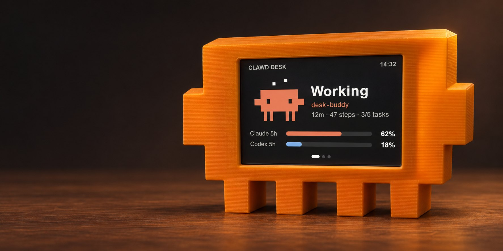

# Clawd Desk (Türkçe)

Masanda duran küçük bir Clawd. 10 dolarlık bir ESP32 dokunmatik ekranda **Claude Code** ve **Codex** limitlerini, ajanının şu an ne yaptığını, onay bekleyen komutları ve son oturumlarını gösterir.

[English](README.md) · Ayrıntılı rehber ve sorun giderme İngilizce README'de.

> Bağımsız bir hayran projesidir. Anthropic veya OpenAI ile bağlantılı değildir.

## Kısaca

- **Ekran kendi kendine döner:** Ana ekran, Limitler ve Canlı oturum arasında her 10 saniyede bir geçer.
- **Olaylar öne çıkar:** Onay bekleyen bir komut varsa ekran o sayfada kalır ve LED sarı yanıp söner. İş bitince Clawd 6 saniye sevinir.
- **Üç büyük dokunma bölgesi var:** sol, orta ve sağ.
- **Gece modu:** Işık sensörü oda kararınca ekranı karartır.
- **BOOT tuşu:** Arkadaki tuşa kısa basınca sonraki ekrana geçer. 2 saniye basılı tutunca renkleri ters çevirir (renkler negatif gibi görünüyorsa). 5 saniye basılı tutunca Wi-Fi ayarını unutur.
- **Dil:** Ekran, bilgisayarının diline göre Türkçe ya da İngilizce olur.

## Kurulum (yaklaşık 5 dakika)

1. **Kartı yükle:** Kartı USB veri kablosuyla tak. Chrome ya da Edge'de **[Clawd Desk yükleyicisini](https://emiryz-162.github.io/clawd-desk/)** aç, kart tipini seç ve **Install Clawd Desk**'e bas.
2. **Wi-Fi'ye bağla:** Telefonundan `ClawdDesk-Setup` ağına bağlan ve açılan sayfadan evdeki Wi-Fi'yi seç.
3. **Bilgisayarı hazırla (Windows):** **[ClawdDesk-Setup.exe](https://github.com/Emiryz-162/clawd-desk/releases/latest/download/ClawdDesk-Setup.exe)** dosyasını indir ve çift tıkla. Program ekranı ağda bulur, Claude Code'u bağlar ve Windows açılışında kendiliğinden başlar.
   - Windows "bilinmeyen yayıncı" uyarısı verirse **Ek bilgi → Yine de çalıştır**'a bas. Program imzalı değil ama bu repodan GitHub Actions ile derleniyor.
   - macOS ya da Linux kullanıyorsan İngilizce README'deki adımlara bak.

Kaldırmak için `%LOCALAPPDATA%\ClawdDesk` klasöründe `clawd-desk.exe uninstall` komutunu çalıştır, sonra klasörü sil.

## Claude limitleri

Program, Claude limitlerini 3 dakikada bir Claude Code'un bilgisayarındaki girişiyle sorar. Bu istek token harcamaz. Girişin süresi dolunca onu Claude Code'un yaptığı gibi kendisi yeniler. Bunun için Claude Code'da bir kez giriş yapmış olman yeterli.

## Lisans

[MIT](LICENSE)
